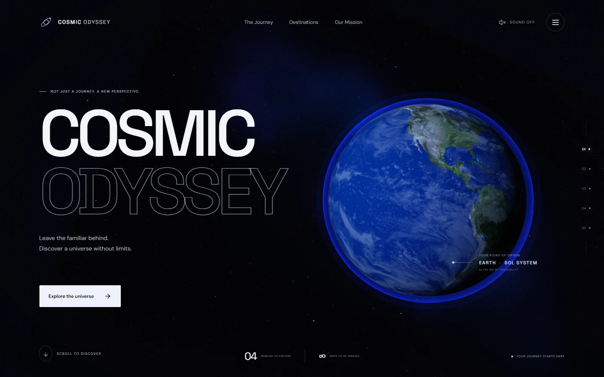
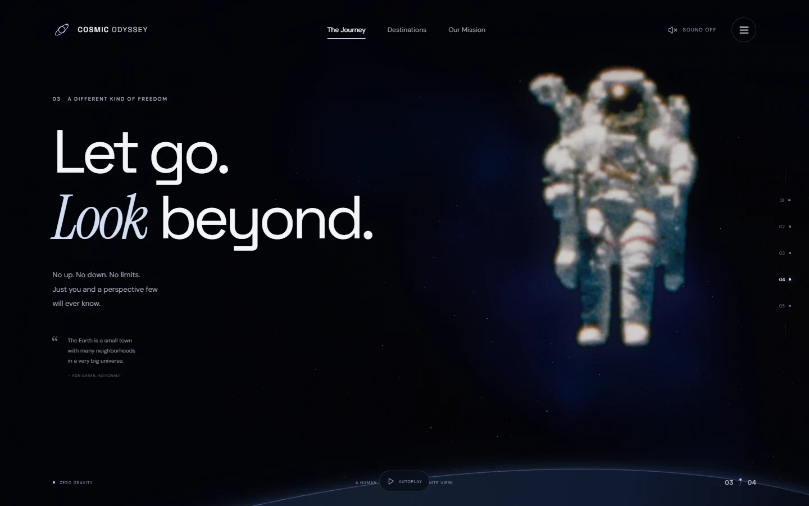
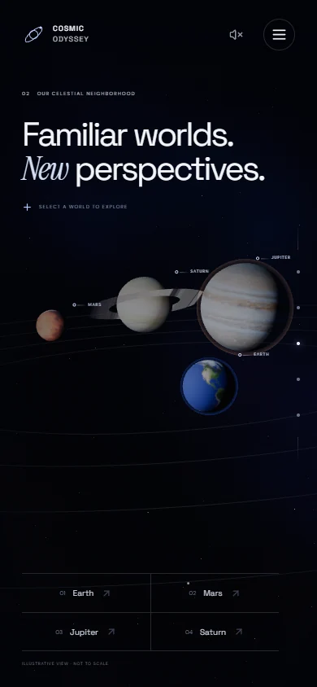
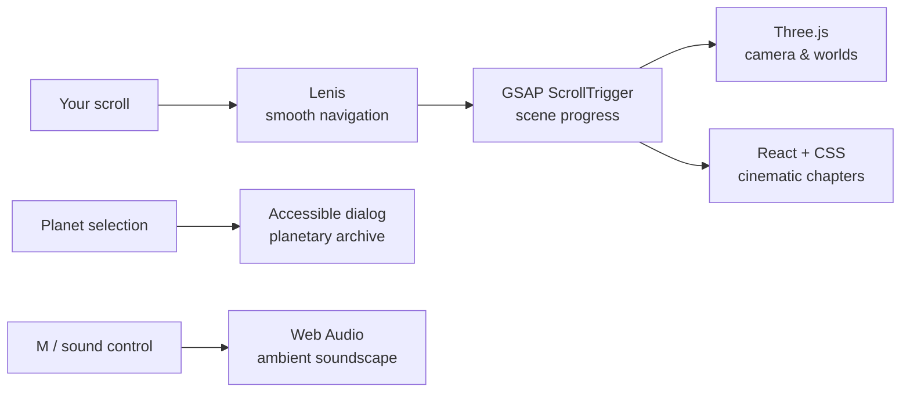

<a id="top"></a>

<div align="center">


<br />

# C O S M I C &nbsp; O D Y S S E Y

### Not just a journey. A new perspective.

**Leave the familiar behind. Discover a universe without limits.**

A cinematic, scroll-driven voyage through real astronomical imagery,<br />
interactive 3D worlds, and the quiet wonder of deep space.

<br />

[](https://react.dev/)
[](https://www.typescriptlang.org/)
[](https://threejs.org/)
[](https://gsap.com/)
[](https://vite.dev/)

<br />

[**Launch locally**](#-launch-in-60-seconds) &nbsp; · &nbsp;
[**Discover the journey**](#-the-flight-plan) &nbsp; · &nbsp;
[**Explore the code**](#%EF%B8%8F-under-the-hood) &nbsp; · &nbsp;
[**Deploy**](#-deploy-your-odyssey)

<br />



</div>

<br />

> [!NOTE]
> **No account. No API keys. No backend.** Install, launch, and explore directly in your browser.

## 🌌 One page. Five chapters. Infinite perspective.

Cosmic Odyssey turns a website into a voyage. Your scroll becomes the flight path: leave Earth, cross a galaxy, meet four familiar worlds, drift beside an astronaut, and arrive at a new way of seeing home.

Built with **React + Three.js + GSAP**, with locally bundled imagery, procedural atmosphere, synthesized ambient audio, and motion that responds to you.

<table>
  <tr>
    <td width="50%" valign="top">
      <h3>🪐 A universe you can touch</h3>
      <p>Select Earth, Mars, Jupiter, or Saturn to open a planetary archive with real astronomical facts.</p>
    </td>
    <td width="50%" valign="top">
      <h3>🎬 Directed by your scroll</h3>
      <p>Camera movement, planetary scale, galaxy parallax, and typography flow together across five cinematic chapters.</p>
    </td>
  </tr>
  <tr>
    <td valign="top">
      <h3>🎧 Space has a soundtrack</h3>
      <p>An optional Web Audio soundscape adds a low cosmic hum. Sound starts off and is always one key away.</p>
    </td>
    <td valign="top">
      <h3>♿ Wonder, without barriers</h3>
      <p>Keyboard navigation, accessible dialogs, reduced-motion support, responsive layouts, and a WebGL fallback are built in.</p>
    </td>
  </tr>
</table>

## 🗺️ The flight plan

| Chapter | Destination | Experience |
| :--- | :--- | :--- |
| **00** | **Origin** | Meet a rotating Earth, wrapped in procedural atmosphere and independent cloud layers. |
| **01** | **Deep Space** | Drift into the Whirlpool Galaxy through layered imagery and a living starfield. |
| **02** | **New Worlds** | Explore four interactive planets and compare their distance, diameter, orbit, and temperature. |
| **03** | **Weightless** | Float beside Bruce McCandless II in NASA's historic untethered spacewalk. |
| **04** | **The Beyond** | Complete the voyage-or begin the guided cinematic journey. |

<div align="center">
  
  <br /><br />
  
  <br />
  <sub><strong>The same odyssey, composed for smaller screens.</strong></sub>
</div>

## 🚀 Launch in 60 seconds

### Prerequisites

- **Node.js 20.19+ or 22.12+**
- **npm** (included with Node.js)
- A modern browser with WebGL support for the full 3D experience

```bash
# 1. Clone your copy of the universe
git clone https://github.com/risterz/cosmic-odyssey.git
cd cosmic-odyssey

# 2. Install dependencies
npm install

# 3. Begin the odyssey
npm run dev
```

Open the URL printed by Vite-normally **[localhost:5173](http://localhost:5173)**. Press `Ctrl+C` to stop.

<details>
<summary><strong>Prefer a production build?</strong></summary>

<br />

```bash
npm run build
npm run preview
```

The optimized site is generated in `dist/`. The preview server normally runs at **[localhost:4173](http://localhost:4173)**.

</details>

## 🎛️ Mission controls

| Control | Action |
| :--- | :--- |
| **Scroll / swipe** | Travel through the chapters |
| **Explore the universe** | Leave Earth and enter the journey |
| **Chapter rail / menu** | Jump directly to a destination |
| **Select a planet** | Open its planetary archive |
| **Autoplay** | Start the guided cinematic journey |
| `M` | Toggle ambient sound |
| `Esc` | Close the menu or active dialog |
| `Tab` / `Shift+Tab` | Navigate interactive controls |

Sound is **off by default**. Reduced-motion preferences disable scripted motion and the automatic tour.

## ⚙️ Under the hood



<table>
  <tr>
    <td><strong>Interface</strong></td>
    <td>React 19 · TypeScript · Vite</td>
  </tr>
  <tr>
    <td><strong>3D universe</strong></td>
    <td>Three.js · custom GLSL shaders · procedural geometry</td>
  </tr>
  <tr>
    <td><strong>Motion</strong></td>
    <td>GSAP ScrollTrigger · Lenis</td>
  </tr>
  <tr>
    <td><strong>Sound & icons</strong></td>
    <td>Web Audio API · Lucide React</td>
  </tr>
  <tr>
    <td><strong>Verification</strong></td>
    <td>Playwright · desktop, mobile, keyboard, and reduced-motion tests</td>
  </tr>
</table>

## 📁 Star map

```text
cosmic-odyssey/
├── public/
│   ├── images/                # Astronomy and astronaut imagery
│   └── textures/              # Local planetary surface textures
├── src/
│   ├── components/
│   │   ├── SpaceCanvas.tsx    # Three.js renderer and scene interaction
│   │   └── BrandMark.tsx      # Cosmic Odyssey emblem
│   ├── data/planets.ts        # Destination content and visual positions
│   ├── hooks/useAmbientSound.ts
│   ├── scene/                 # Shaders and procedural scene helpers
│   ├── App.tsx                # Chapters, dialogs, navigation, and motion
│   └── styles.css             # Responsive visual system
├── tests/journey.spec.ts      # End-to-end browser checks
├── docs/media/                # Documentation screenshots
└── vite.config.ts             # Build and chunk configuration
```

## ✅ Verify before takeoff

```bash
# Type-check and create a production build
npm run build

# Install the portable test browser (first run only)
npx playwright install chromium

# Run all browser tests
npx playwright test

# Optional: view the latest test report
npx playwright show-report
```

The suite covers desktop navigation, planet archives, sound controls, menu focus handling, mobile layout, viewport resizing, and reduced motion. On Windows it uses installed Google Chrome when available; elsewhere it uses Playwright Chromium.

<details>
<summary><strong>Using a custom Chrome installation?</strong></summary>

<br />

Set `PLAYWRIGHT_CHROMIUM_EXECUTABLE_PATH` to its executable path.

```bash
# macOS / Linux
PLAYWRIGHT_CHROMIUM_EXECUTABLE_PATH="/path/to/chrome" npx playwright test
```

```powershell
# Windows PowerShell
$env:PLAYWRIGHT_CHROMIUM_EXECUTABLE_PATH = "C:\path\to\chrome.exe"
npx playwright test
```

</details>

## ☁️ Deploy your odyssey

Cosmic Odyssey is a static Vite application. Deploy `dist/` to **Netlify**, **Vercel**, **Cloudflare Pages**, or any static host.

| Setting | Value |
| :--- | :--- |
| **Build command** | `npm run build` |
| **Output directory** | `dist` |
| **Install command** | `npm install` |
| **Environment variables** | None required |

> [!IMPORTANT]
> Asset URLs are root-relative. If deploying to a repository subpath such as `username.github.io/cosmic-odyssey/`, configure Vite's `base` and the asset paths for that subpath first.

## 🛠️ Performance & accessibility

- Reused geometry and textures; pixel ratio capped at `1.75`.
- Rendering pauses when the browser tab is hidden.
- Three.js resources are disposed on unmount.
- Local images and textures; Google Fonts is the only optional external font request.
- Keyboard-operable dialogs and menu, visible focus states, and hidden-control management.
- Responsive desktop/mobile choreography with reduced-motion alternatives.
- Static fallback imagery when WebGL is unavailable.

## 🌍 Credits & scientific notes

- **Planet and ring textures:** [Solar System Scope](https://www.solarsystemscope.com/textures/), **CC BY 4.0**. Colors and rendering are adapted for this experience.
- **Astronaut:** NASA photograph **S84-27562**, Bruce McCandless II's first untethered spacewalk, **7 February 1984**.
- **Whirlpool Galaxy:** NASA/ESA Hubble, **HEIC0506A**.
- **Andromeda:** NASA/ESA Hubble, **HEIC1502A**. Additional astronomical imagery: NASA/ESA Hubble.
- **Typography:** Space Grotesk and DM Sans via Google Fonts.

The solar-system scene is **illustrative and not to scale**. Planetary temperatures are mean values; Earth's temperature is a global average.

## 🤝 Keep exploring

Have an idea for another world, a smoother camera move, or a more accessible journey?

1. Fork the repository and create a feature branch.
2. Keep the existing scroll choreography and asset credits intact.
3. Run `npm run build` and `npx playwright test`.
4. Open a pull request describing your change and testing.

<br />

<div align="center">

**STAY CURIOUS. KEEP EXPLORING.**

<sub>Made with code, starlight, and a little perspective. ✦</sub>

[**Back to Earth ↑**](#top)

</div>
